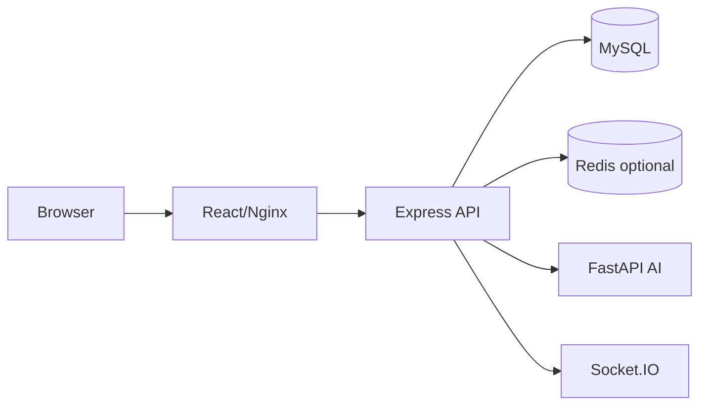

# Architecture

React/Vite presents the driver and operations consoles. Express owns authentication, authorization, reservation transactions, simulated traffic, Socket.IO events, and the integration boundary to FastAPI. FastAPI exposes versioned prediction endpoints. MySQL is the durable source of truth; Redis is the optional cache and can be unavailable without preventing core reads. Docker Compose supplies the local network; AWS ECS Fargate, RDS, ElastiCache, and an ALB are the production equivalents.

